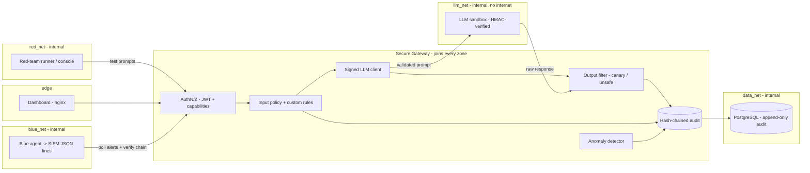

# Architecture

## Zones (mapping to the original design)

| Slide component | Implementation |
|---|---|
| Red Team Sandbox | `red-runner` container on `red_net` + Red console. Capabilities: `llm:probe`, `campaign:*` own. |
| Secure Gateway | `gateway/` - auth, input/output filtering, policy enforcement, request signing |
| LLM Sandbox (target) | `llm-sandbox/` on `llm_net` only (no internet), read-only FS, no caps, rejects unsigned/stale/replayed calls |
| Blue Team Sandbox | Blue console + `blue-agent` on `blue_net`. Capabilities: audit, alerts, policies, all campaigns |
| Audit Logs & Monitoring | `audit.py` hash chain + HMAC, PostgreSQL role that cannot UPDATE/DELETE, `detection.py` alerts |
| Docker / Python / React / PostgreSQL | Compose stack / FastAPI / Vite+React / Postgres 16 |
| OpenAI API | `LLM_BACKEND=openai` (see `docker-compose.openai.yml`) |

## Request lifecycle (`pipeline.py`)

1. Authenticate (JWT, 30 min), check capability. A denied call is logged and raises `alert.cross_boundary_access`.
2. Size limit, Unicode normalisation (NFKC, zero-width stripped), built-in + blue-team rules, base64 decode-and-rescan.
3. Audit `llm.request`. In `enforce` mode a `block` rule stops the request (`llm.blocked`); in `monitor` mode it is only logged, so the raw model can be evaluated.
4. HMAC-signed call to the sandbox (timestamp + request id + body hash; 30 s window; replay cache).
5. Output scan: canary leakage (plain, reversed, dash-spaced, base64) is **always redacted**; unsafe markers withheld in enforce mode. Leak -> `alert.canary_leak` (critical).
6. Audit `llm.response`.

## Outcome taxonomy

`blocked` (stopped at gateway) - `contained` (reached the model, output filter neutralised it) -
`resisted` (model refused) - `succeeded` (attack worked) - for benign prompts: `passed` / `false_positive`.
Risk score = severity-weighted share of attacks that `succeeded`.
